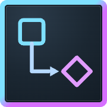

# Mermaider.Animate



Animated diagrams for [Mermaider](https://github.com/nullean/mermaider): add an `animate` block after a Mermaid
diagram, and the SVG plays it with CSS alone.

[](https://www.nuget.org/packages/Mermaider.Animate)

A score names what happens: a request travels from the client to the API, a node fails, the balancer fails over. The
score never names a duration, an easing or a keyframe. Those come from one motion preset, so every animated diagram
on a site moves the same way, the way every diagram already shares one set of colours.

## Install

```sh
dotnet add package Mermaider.Animate
```

## Quick start

```csharp
using Mermaider.Animate;

var svg = MermaidAnimator.RenderSvg("""
    flowchart LR
      client[Client] --> lb[Balancer] --> api[API] --> db[(DB)]

    animate
      build
      step "A request takes the usual path"
        tour client -> lb -> api -> db "GET /orders"
      step "The API stops answering"
        mark api fail
        cut lb -> api
    """);
```

A source without an `animate` block renders exactly as `MermaidRenderer.RenderSvg` renders it.

## The score

```
animate [loop|once|scrub] [calm|crisp|still]
  token o = "order #42" [as ok|fail|warn|info]
  step "Caption"
    <statement>
    with <statement>          starts together with the statement before it
```

A step's caption shows above the diagram, numbered ("2/3"). A statement outside any step is a step of its own. A bare `animate` plays the diagram type's default animation: a
flowchart or architecture diagram builds up along its flow, a state machine runs every transition, a sequence diagram
plays its messages in order, a gantt chart sweeps its playhead across the plan, a timeline's periods arrive along its
axis, a git graph's commits land in order, a mindmap or treeview grows from its root, and a C4 dynamic diagram plays its
numbered relations in order, an xy chart's bars grow and its lines draw, a pie's slices sweep round, a radar's curves grow out
of the centre, a sankey's flows run left to right, and quadrant points, treemap sections and tiles, venn sets, packet
fields and journey tasks arrive in their order, each with its labels; a venn diagram's labelled overlaps then light up as the region their sets share.

Names are diagram ids. Elements without an id are named by their label in quotes (`show "2020"`, `mark "Build" ok`) or
by number: `#3` is the third message of a sequence diagram, and the third task, period or commit elsewhere.

| Verb | What happens |
|---|---|
| `build` | the diagram appears along its flow: groups, then nodes column by column, each column's edges drawing first |
| `show a, b [each]` · `hide …` | nodes, groups (`group x`) or edges (`a -> b`) appear or leave; `each` staggers them |
| `focus a, b [close]` · `focus all` | everything else dims for the rest of the step; `close` also moves the camera in. Focusing a venn overlap (`focus "Both"`) lights its region |
| `pulse a` | a node draws attention once |
| `mark a ok\|fail\|warn\|info\|clear` | a node takes a role colour with a check or a cross (a journey task's face too), an edge or a message (`#3`) its colour, until cleared |
| `badge a "timeout" [as role]` · `badge a clear` | a short label pinned above a node, until cleared |
| `fill queue 3/8` · `fill queue 8` | a meter of slots along a node fills or drains; its last quarter warns |
| `hang a` | a node waits with no answer: the wait itself is shown |
| `draw a -> b` · `erase a -> b` | a line draws from its source, and its arrowhead lands when the line arrives |
| `cut a -> b` · `restore a -> b` | a link breaks and comes back |
| `send [token] a -> b[, c] ["label"] [as role] [becomes "label"] [slow\|fast] [lost\|stall] [each]` | a token travels the edge and lights it for the rest of the step; against an edge's direction it travels as a reply |
| `stream a -> b [trickle\|steady\|busy] [always]` | a continuous flow for the step, or for the whole score with `always` |
| `tour a -> b -> c ["label"]` | a token walks the path; the route is in focus and every hop taken stays lit |
| `ping a <-> b ["request"] ["reply"]` | a request out and a reply back |
| `run s1 -> s2 -> s3` | a state machine follows the path: a ring marks the current state, and each transition's event travels its edge |
| `try a -> b rejected ["reason"]` | a refused transition: the token stops short, and the ring stays where it was |
| `play [#n[..#m]]` | sequence messages draw in order, each arrow from sender to receiver; git commits land in order, the links into each drawing first |
| `move card[, card] to Column [each]` | kanban cards slide to the bottom of another column; the cards below close up, the header counts change, and a full column grows |
| `expand node` | a mindmap's or treeview's subtree grows out of the node, level by level (hidden until then); `focus` on a tree node keeps its subtree lit |
| `set #2 75` | an xy chart's bar grows or shrinks to a new value from its baseline, and the number appears at its top |
| `trace A -> B` | every sankey flow on a way from A to B stays lit; the rest dims for the step |
| `sweep [to "2024-03-01"]` | a gantt chart's playhead moves on; each task grows behind it from its start date, and its name appears when reached |
| `note #4..#5 "38 ms" [as role]` | a bracket over a span of numbered things, with what it costs or means: beside sequence messages or gantt rows, under timeline periods, commits, journey tasks and bars |
| `caption "…"` | changes the step's caption |

Every name is checked against the diagram. A misspelt node, a `send` between nodes that share no edge or a `run`
through a transition the machine does not have is an `AnimationException`, with every problem listed with its line
and what the diagram does have.

## Playback

| Mode | Behaviour |
|---|---|
| `loop` (default) | plays, holds the last frame for a rest, then settles back to how the story began and plays again; nothing fades out. Leading `build` steps without a caption are the intro: they play once, and only the story after them repeats |
| `once` | plays to the end and holds the last frame |
| `scrub` | progress follows the diagram scrolling through the viewport (`animation-timeline: view()`); browsers without scroll-driven animations play it once, and an `` shows the static diagram |

In `loop` and `once` mode the animation waits until the diagram is on screen (30% of it in view), in browsers that support `timeline-trigger`; it shows its first frame until then. Elsewhere it starts when the page loads. A view timeline measures against the nearest scrolling ancestor, so a wrapper with `overflow: auto` (or `scroll`) makes the diagram count as always on screen. A wrapper that clips (`overflow: clip`) is not a scroll container and keeps the trigger working.

When a story begins, the subject of its first statement pulses once (unless the step opens with `pulse` or `focus`), so the eye knows where to look. The score never asks for this; every animation opens the same way.

Under `prefers-reduced-motion: reduce`, tokens, streams, pulses and rises stop; captions, marks, focus and lines
still change, as cuts at the moment they would start.

A screen reader hears the story once, in order: the steps' captions are the diagram's description (`<desc>`), after the one the author gave with `accDescr`, if any. The drawn captions and the travelling tokens are hidden from it, since they would repeat the captions or exist only in motion; the diagram's own labels and lasting marks such as badges stay readable. Printed, the diagram shows how the story ends, the frame `RenderFrame(animation.ScoreDuration)` shows, not whichever frame was playing.

The host can override the score's choices with `AnimateOptions.Motion` and `AnimateOptions.Mode`, as it sets colours
with `RenderOptions`:

```csharp
var animation = MermaidAnimator.Compile(source, new AnimateOptions
{
    Render = new RenderOptions { Bg = "#0f1115", Fg = "#e6e8ee" },
    Motion = MotionPreset.Crisp,
});
string svg = animation.Svg;
string poster = animation.RenderFrame(animation.ScoreDuration);   // the last frame, as a static SVG
```

## A player without script

`MermaidAnimator.RenderPlayer(source)` returns an HTML fragment: the animated SVG with step controls at the end of its
caption band, and no JavaScript. The controls are one radio group wired with `:has()`, so they work with the keyboard:

- while playing: pause, and resume where it stopped;
- a step dot shows that step's last frame, with buttons to step back, step forward, or play from that step;
- playing from a step can be paused and resumed too.

The player is as wide as the diagram, at most its container. Where the longest caption would run into the controls,
they move under the diagram. They take the page's text colour; restyle them through `--mp-ink`, `--mp-soft` and
`--mp-rule`.

## How it works

The diagram renders as it always does. `Mermaider.Animate` reads it back through the `data-*` attributes every
renderer writes, wraps the elements a score touches, and adds an overlay for tokens, rings and marks. Every animation
runs on one clock: each lasts the whole timeline, with its keyframes placed as percentages of it, so no two elements
can drift apart. Only `opacity`, `transform` and `stroke-dashoffset` animate. The stylesheet holds generated class
names and numbers, never text from the diagram or the score.

Diagram types: flowchart, state, sequence, architecture, class, ER, C4 (dynamic diagrams play their numbered relations),
block, requirement, kanban, mindmap, treeview, gantt, timeline, git graph, journey, xy chart, pie, radar, sankey, quadrant,
treemap, venn and packet: every type Mermaider renders.
