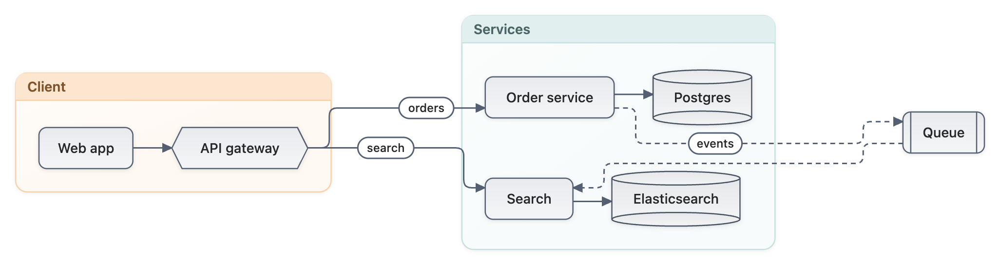

# Mermaider.Cli


The `mermaid` command: render [Mermaid](https://mermaid.js.org/) diagrams to SVG, or draw them as text, from the
command line. Pure .NET, no browser.

[](https://www.nuget.org/packages/Mermaider.Cli)



## Install

```sh
dotnet tool install -g Mermaider.Cli
```

## Quick start

```sh
echo 'graph TD
  A --> B' | mermaid > diagram.svg

mermaid input.mmd -o output.svg --theme github-dark
mermaid input.mmd -o output.svg --style blueprint --elevation 0
mermaid input.mmd -o output.svg --style tonal --no-gradient --tint 0.8
mermaid input.mmd --ascii          # draw it as text
mermaid input.mmd --plain --width 80
mermaid --list-themes
```

`mermaid --help` lists every option: `--theme`, `--style` (`quiet`, `blueprint`, `tonal`), `--no-transparent`,
`--no-gradient`, `--tint`, `--elevation`, and `--ascii` / `--plain` with `--width` for text output.

## Learn more

- Documentation: https://mermaider.nullean.net
- The library underneath: [Mermaider](https://www.nuget.org/packages/Mermaider)
- Source and issues: https://github.com/nullean/mermaider
