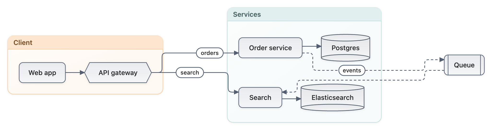

# Mermaider


Render [Mermaid](https://mermaid.js.org/) diagrams to SVG in pure .NET. No browser, no DOM, no JavaScript runtime.
AOT-ready.

[](https://www.nuget.org/packages/Mermaider)



## Install

```sh
dotnet add package Mermaider
```

## Quick start

```csharp
using Mermaider;

var svg = MermaidRenderer.RenderSvg("""
    graph TD
      A[Start] --> B{Decision}
      B -->|Yes| C[OK]
      B -->|No| D[End]
    """);

// the same diagram as text, for a terminal, a log or a pull-request comment
var text = MermaidRenderer.RenderAscii("""
    flowchart LR
      A[(OrderEvents)] -->|"2/s"| B{{Orders}}
      B --> C[Order]
    """);
```

Hand it a Mermaid string; get a sanitized, consistently styled SVG back. No interop, no child processes, no headless
browsers.

- **Pure .NET, zero interop:** just a NuGet reference. No Chromium, no Node.js, no subprocess management.
- **Native AOT:** every public API proven in CI on Linux, macOS and Windows.
- **Built-in layout engine:** [Sugiyama](https://www.nuget.org/packages/Sugiyama), a zero-dependency layered layout
  with compound subgraphs and an orthogonal edge router.
- **24 diagram types:** one API, one theming model for all of them.
- **Unified theming:** 15 themes, live-switchable via CSS custom properties.
- **Always-on SVG sanitization:** allowlist-only, no opt-out.
- **Strict styling mode:** enforce your design system on user-authored diagrams.
- **Fast:** ~95 µs and ~209 KB allocated to render a simple flowchart end to end.

## Learn more

- Documentation: https://mermaider.nullean.net
- The full reference, with every render option and an example of each diagram type: https://github.com/nullean/mermaider#readme
- The command line tool: [Mermaider.Cli](https://www.nuget.org/packages/Mermaider.Cli)
- Source and issues: https://github.com/nullean/mermaider
